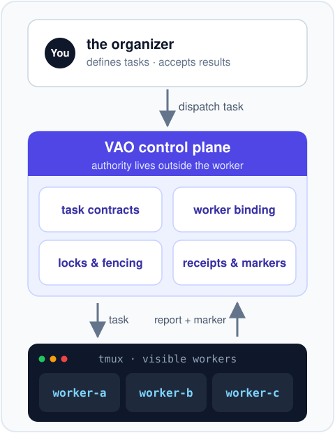
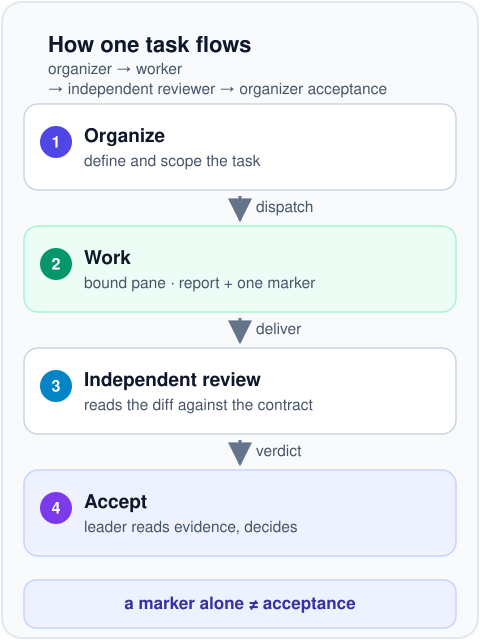

# Visible Agent Orchestrator

**An outer control plane for AI coding agents you keep in plain sight: task
authority, dispatch, evidence and acceptance stay with you — not inside the
worker.**

English | [简体中文](README.zh-CN.md)



## The problem it solves

Coding agents such as OpenCode or Codex live in tmux panes, do real work, and
are only a paste away. Coordinating several of them by hand is where it falls
apart:

- **Lost task ownership** — two agents pick up "the" task, or nobody does;
  there is no single record of who was asked what.
- **Stale targets** — you paste a task into a pane whose session has moved on,
  mixing contexts and corrupting work.
- **Duplicate submissions** — the same task is dispatched twice because state
  lived in someone's memory.
- **No reliable handoff** — output arrives as scrollback, with no durable
  record of what was requested, attempted, verified, or accepted.

VAO moves that protocol out of the agents and into a control plane you operate.

## What it is

Visible Agent Orchestrator (VAO) is a Linux control plane for visible CLI
workers, with a tmux-backed reference runtime for visible OpenCode workers. It
does not wrap, patch or replace your agents: it binds each registered worker to
one concrete live pane and keeps every authority — authorization, dispatch,
evidence, acceptance — outside the worker itself.



In plain terms:

- **Binding** — a registered worker is tied to one live pane in your current
  tmux window. Dispatch and similar mutating operations require a verified
  current binding; read-only inventory and repairable-rebind checks remain
  available when a binding is broken.
- **Scoped authorization** — every task carries an explicit contract: allowed
  paths, required checks, and the exact finish command. Task files can narrow
  permissions, never expand them.
- **Locks and fencing** — one owner per task and worker; duplicate or stale
  submissions are refused. A caller timeout is not completion: the same
  attempt may still be running with its lock retained, so observe it rather
  than dispatching again.
- **Receipts and signals** — received, started and heartbeat progress are
  recorded by the control plane, not by goodwill.
- **Report + one terminal marker** — a task is only complete with a non-empty
  `report.md` and exactly one of `.done`, `.fail`, or `.blocked`.
- **Acceptance stays with the organizer** — the marker records protocol
  completion, nothing more. The organizer still reads the report and decides;
  worker completion never proves semantic correctness.

## What it's good for

- **Implementation + independent review** — dispatch an implementation task to
  one worker and a read-only review of the same change to another; both run in
  separate panes against the same contract, and acceptance waits for both.
- **Parallel evidence collection** — fan out bounded tasks (log summaries,
  doc checks, link verification), each with its own scope and receipts, then
  integrate the results yourself.
- **Any delegated work that needs an audit trail** — who was asked what, which
  attempt ran, what came back, and who accepted it.

## Plugins

VAO ships exactly two plugins, both registry-managed companion Skills released
as immutable, parity-checked generations:

| Plugin | What it gives you |
|---|---|
| [visible-agent-orchestrator-skill-v0](plugins/visible-agent-orchestrator-skill-v0) | The VAO companion Skill: root resolution, binding and readiness checks, dispatch and acceptance guidance for agents operating a VAO runtime. |
| [ag2-meeting-runtime](plugins/ag2-meeting-runtime) | AG2-style structured meetings with `idea-review` and `code-design-review` profiles. Deterministic and offline by default — no model, tmux, or worker calls. Real model execution is a separate, explicitly approved host-local path, never enabled by a profile. |

The generic provider and CLI adapters in `bin/` are development integration
surfaces, not bundled plugins or proven product integrations.

## Requirements

- Linux with tmux — the supported reference runtime
- Python 3.11 or newer
- OpenCode — only when running visible OpenCode workers; the control plane and
  the meeting helper work without it
- Git — for source installation and companion-Skill release checks

VAO does not install or modify OpenCode, Codex, model providers, tmux, or
credentials. Experimental `rmux` adapters are not part of the supported
runtime.

## Install into an isolated prefix

From a clean checkout, pick an explicit runtime root and keep business
repositories outside it:

```bash
export VAO_ROOT="$HOME/vao-runtime"
export VAO_BACKUP="$HOME/.local/state/vao-install-backups/initial"

# Once per user: initialize the host-local authorization lifecycle.
./bin/omx_install_sync bootstrap-companion-skills \
  --task-id initial-setup --attempt-id bootstrap-1 \
  --authorize-leader --allow-write --json

./bin/omx_install_sync plan \
  --source "$PWD" --target "$VAO_ROOT" \
  --manifest install/visible-agent-orchestrator.install-manifest.json

./bin/omx_install_sync check \
  --source "$PWD" --target "$VAO_ROOT" \
  --manifest install/visible-agent-orchestrator.install-manifest.json

./bin/omx_install_sync apply \
  --source "$PWD" --target "$VAO_ROOT" \
  --backup-dir "$VAO_BACKUP" \
  --manifest install/visible-agent-orchestrator.install-manifest.json \
  --allow-write --smoke
```

`plan` and `check` are non-mutating; `apply` additionally requires the
bootstrapped lifecycle and `--allow-write`. The supplied manifest uses
`offline_bootstrap`: it requires absent install targets and no existing worker
state, then verifies every installed command with `--help` without contacting
a worker or provider. Updating an existing runtime instead needs a reviewed
manifest with `post_install_smoke_profile` set to `default` plus
`--smoke --smoke-worker <verified-worker-id>`. Always pass the same quoted
root explicitly; see [Portability](docs/PORTABILITY.md) for paths with spaces
and root isolation.

## First look around

Inventory is read-only and does not authorize anything:

```bash
"$VAO_ROOT/bin/omx_visible_dispatch" status \
  --root "$VAO_ROOT" --all-workers --json
```

Before dispatching a real task, read the
[Operator guide](docs/OPERATOR_GUIDE.md) — it covers binding checks, session
actions (`keep` / `compact` / `rotate` / `recovery`), dispatch, and what
protocol completion does and does not prove.

## Offline meeting helper

A quick structured self-review, no model required:

```bash
"$VAO_ROOT/bin/omx_ag2_meeting" \
  --root "$PWD" \
  --profile code-design-review \
  --task "Review this design" \
  --json
```

This path is deterministic and offline: it writes meeting artifacts under the
supplied workspace root and skips models, tmux, and visible workers entirely.

## Documentation

- [Operator guide](docs/OPERATOR_GUIDE.md) — dispatch, session actions, acceptance
- [Portability](docs/PORTABILITY.md) — runtime roots, path handling, isolation
- [VAO companion Skill](plugins/visible-agent-orchestrator-skill-v0) and
  [AG2 meeting runtime](plugins/ag2-meeting-runtime) — the two shipped plugins

## Safety model

The worker is never the authority. A valid run needs current binding,
task-scoped authorization, an available target lock, a selected session action,
and a terminal fence; completion needs a non-empty report and exactly one
terminal marker. A quiet pane, an idle worker, or a marker by itself proves
nothing — the organizer inspects the evidence and makes the content decision.

Keep provider configuration, credentials, live approval JSON, and task evidence
out of this repository; host-local registration and runtime state stay under
the selected runtime root.

## Development

Read [AGENTS.md](AGENTS.md) before changing contracts or runtime behavior. Run
the narrowest relevant tests, and keep the published tree free of host paths,
credentials, domain-specific extensions, caches, and runtime evidence.

## License

MIT. See [LICENSE](LICENSE).
