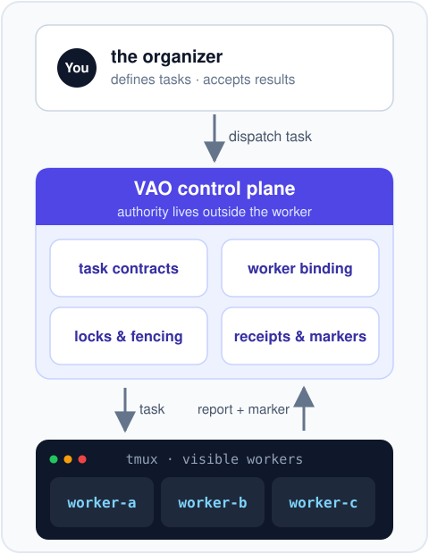
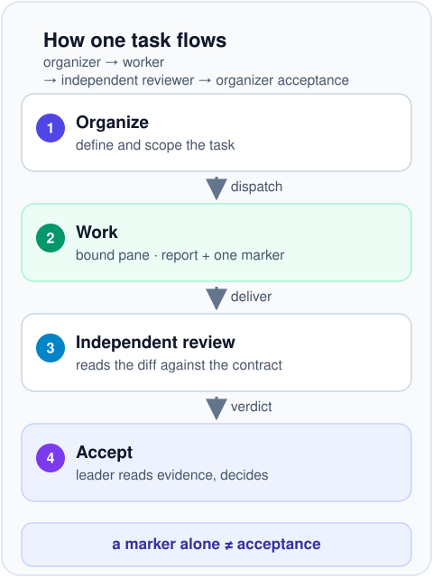

# Visible Agent Orchestrator

**一个让 AI 编程智能体始终运行在你视野之内的外部控制平面：任务授权、
分发、证据与验收都掌握在你手中，而不是藏在智能体内部。**

[English](README.md) | 简体中文



## 它解决什么问题

OpenCode、Codex 这类编程智能体运行在 tmux 窗格里，能做真正的工作，一次
粘贴就能驱动。但靠人肉协调多个智能体时，问题随之而来：

- **任务归属丢失** —— 两个智能体同时认领"那个"任务，或者谁都没做；
  没有一份权威记录说明谁被要求做什么。
- **目标过期** —— 你把任务粘贴进一个会话早已切换的窗格，上下文混淆，
  工作被污染。
- **重复提交** —— 同一个任务被分发两次，只因状态存在某个人的记忆里。
- **交付不可靠** —— 产出只是终端滚动区里的一段文字，没有关于"要求了
  什么、尝试了什么、验证了什么、谁验收了"的持久记录。

VAO 把这套协议从智能体内部搬到由你掌控的控制平面。

## 它是什么

Visible Agent Orchestrator（VAO）是一个面向可见 CLI 工作者的 Linux
控制平面，提供以 tmux 为支撑的参考运行时，用于可见的 OpenCode 工作者。
它不封装、不修补、不替换你的智能体：它把每个已注册的工作者绑定到唯一
一个真实存活的窗格，并把所有权威——授权、分发、证据、验收——保留在
工作者之外。



用通俗的话说：

- **绑定（Binding）** —— 已注册的工作者与你当前 tmux 窗口中唯一一个
  存活窗格绑定。分发及类似的变更操作要求已验证的当前绑定；绑定失效时，
  只读检查与可修复的重绑定检查依然可用。
- **范围化授权** —— 每个任务携带显式契约：允许的路径、必需的检查、
  精确的完成命令。任务文件只能收窄权限，绝不能扩大。
- **锁与栅栏（Locks & fencing）** —— 每个任务和工作者的属主唯一；
  重复或过期的提交会被拒绝。调用方超时不等于完成：同一尝试可能仍在
  运行并持有其锁，应继续观察它，而不是再次分发。
- **回执与信号** —— received、started、heartbeat 进度由控制平面记录，
  而不是靠自觉。
- **报告 + 唯一终端标记** —— 只有附带非空 `report.md` 且恰好存在
  `.done`、`.fail`、`.blocked` 之一，任务才算协议完成。
- **验收权保留在组织者** —— 终端标记只记录协议完成，仅此而已。组织者
  仍要阅读报告并做出决定；工作者完成永远不证明语义正确。

## 适合的场景

- **实现 + 独立评审** —— 把实现任务分发给一个工作者，把同一变更的
  只读评审分发给另一个；两者在各自窗格中对照同一契约工作，验收等待
  双方结果。
- **并行证据收集** —— 扇出多个有边界的任务（日志摘要、文档检查、
  链接核验），各自拥有独立的作用域与回执，最后由你整合结果。
- **任何需要审计轨迹的委托工作** —— 谁被要求做什么、哪次尝试在运行、
  交回了什么、由谁验收。

## 插件

VAO 恰好发布两个插件，均为注册表管理的伴随 Skill，以不可变、经过
字节校验的世代发布：

| 插件 | 提供什么 |
|---|---|
| [visible-agent-orchestrator-skill-v0](plugins/visible-agent-orchestrator-skill-v0) | VAO 伴随 Skill：为操作 VAO 运行时的智能体提供根解析、绑定与就绪检查、分发与验收指引。 |
| [ag2-meeting-runtime](plugins/ag2-meeting-runtime) | AG2 风格的结构化会议，含 `idea-review` 与 `code-design-review` 两个 profile。默认确定性与离线——不调用模型、tmux 或工作者。真实模型执行是一条单独的、需显式批准的宿主本地路径，任何 profile 都不会启用它。 |

`bin/` 中的通用 provider 与 CLI 适配器是开发集成接口，不是随附插件，
也不是已验证的产品集成。

## 环境要求

- Linux 与 tmux —— 受支持的参考运行时
- Python 3.11 或更新版本
- OpenCode —— 仅在运行可见 OpenCode 工作者时需要；控制平面与会议
  助手无需它即可工作
- Git —— 用于源码安装与伴随 Skill 发布检查

VAO 不安装或修改 OpenCode、Codex、模型提供商、tmux 或凭据。实验性的
`rmux` 适配器不属于受支持的运行时。

## 安装到隔离前缀

从干净的检出出发，选择一个显式运行时根目录，并把业务仓库放在它之外：

```bash
export VAO_ROOT="$HOME/vao-runtime"
export VAO_BACKUP="$HOME/.local/state/vao-install-backups/initial"

# 每个用户一次：初始化宿主本地的授权生命周期。
./bin/omx_install_sync bootstrap-companion-skills \
  --task-id initial-setup --attempt-id bootstrap-1 \
  --authorize-leader --allow-write --json

./bin/omx_install_sync plan \
  --source "$PWD" --target "$VAO_ROOT" \
  --manifest install/visible-agent-orchestrator.install-manifest.json

./bin/omx_install_sync check \
  --source "$PWD" --target "$VAO_ROOT" \
  --manifest install/visible-agent-orchestrator.install-manifest.json

./bin/omx_install_sync apply \
  --source "$PWD" --target "$VAO_ROOT" \
  --backup-dir "$VAO_BACKUP" \
  --manifest install/visible-agent-orchestrator.install-manifest.json \
  --allow-write --smoke
```

`plan` 与 `check` 不做任何变更；`apply` 额外要求已初始化的生命周期与
`--allow-write`。随附清单使用 `offline_bootstrap`：它要求安装目标不存在
且没有任何工作者状态，然后仅用 `--help` 验证每个已安装命令，不接触任何
工作者或 provider。若要更新已存在的运行时，则需要一份将
`post_install_smoke_profile` 设为 `default` 的经审清单，外加
`--smoke --smoke-worker <verified-worker-id>`。始终显式传递同一个加引号
的根目录；含空格路径与根隔离见[移植性说明](docs/PORTABILITY.md)。

## 初步查看

清单命令只读，不构成任何授权：

```bash
"$VAO_ROOT/bin/omx_visible_dispatch" status \
  --root "$VAO_ROOT" --all-workers --json
```

在分发真实任务之前，请阅读[操作指南](docs/OPERATOR_GUIDE.md)——它涵盖
绑定检查、会话动作（`keep` / `compact` / `rotate` / `recovery`）、分发，
以及协议完成能证明什么、不能证明什么。

## 离线会议助手

一次快速的结构化自审，无需模型：

```bash
"$VAO_ROOT/bin/omx_ag2_meeting" \
  --root "$PWD" \
  --profile code-design-review \
  --task "Review this design" \
  --json
```

该路径确定且离线：它在给定的工作区根目录下写入会议产物，完全跳过模型、
tmux 与可见工作者。

## 文档

- [操作指南](docs/OPERATOR_GUIDE.md) —— 分发、会话动作、验收
- [移植性说明](docs/PORTABILITY.md) —— 运行时根、路径处理、隔离
- [VAO 伴随 Skill](plugins/visible-agent-orchestrator-skill-v0) 与
  [AG2 会议运行时](plugins/ag2-meeting-runtime) —— 两个随附插件

## 安全模型

工作者永远不是权威。一次合法运行需要当前绑定、任务范围授权、可用的
目标锁、已选择的会话动作和终端栅栏；完成需要非空报告和恰好一个终端
标记。安静的窗格、空闲的工作者或单独的标记都不能证明任何事——组织者
检查证据并做出内容层面的决定。

不要把 provider 配置、凭据、生效审批 JSON 或任务证据放进本仓库；宿主
本地注册与运行时状态保持在所选运行时根之下。

## 开发

在更改契约或运行时行为之前阅读 [AGENTS.md](AGENTS.md)。先运行最窄的
相关测试，并保持发布树不含宿主路径、凭据、领域扩展、缓存与运行时证据。

## 许可

MIT，见 [LICENSE](LICENSE)。
